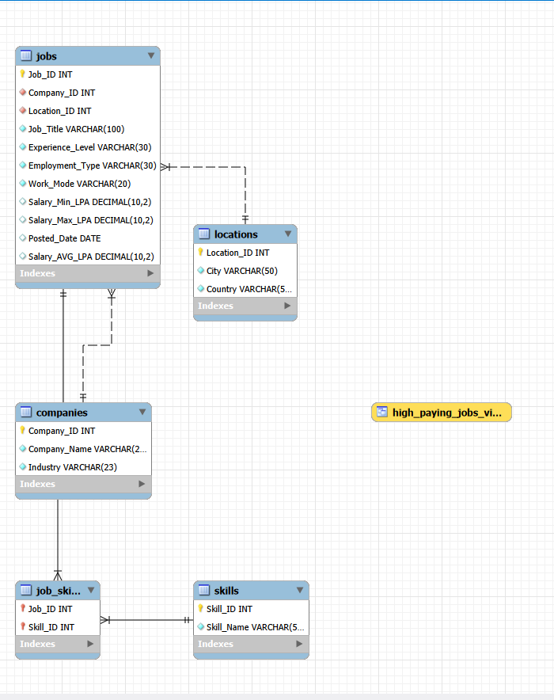

# Job Market Intelligence | Skills, Salaries & Hiring Trends

A SQL-based data analytics project exploring job opportunities, salary ranges, hiring activity, experience levels and skill requirements using a relational MySQL database.

**Tools:** MySQL • MySQL Workbench | **Scope:** 5 related tables • 50 numbered query exercises • 9 analytical phases

## Business objective

- Identify high-paying roles and compare compensation across experience levels.
- Explore hiring activity by company, industry and location.
- Understand job-specific skill requirements and work-mode preferences in the dataset.
- Build reusable SQL queries for job-market analysis.

## Database design

The `job_intelligence` database contains five tables:

| Table | Purpose |
|---|---|
| `jobs` | Job titles, experience, employment type, work mode, salary ranges and posting dates |
| `companies` | Company names and industries |
| `locations` | Cities and countries |
| `skills` | Skill names |
| `job_skills` | Many-to-many bridge between jobs and skills |

### Entity relationship diagram

## SQL techniques demonstrated

| Phase | Techniques |
|---|---|
| 1 | Filtering, sorting, DISTINCT, LIMIT, GROUP BY, HAVING, aggregate functions |
| 2 | String, date and numeric functions; derived salary column |
| 3 | DELETE within a transaction and ROLLBACK |
| 4 | INNER, LEFT and RIGHT JOIN; UNION |
| 5 | Single-row subqueries and aggregate comparisons |
| 6 | Nested and multiple-row subqueries, IN, ANY, ALL |
| 7 | RANK, DENSE_RANK, ROW_NUMBER, AVG OVER, FIRST_VALUE |
| 8 | Reusable views for job-market and high-paying job analysis |
| 9 | Common table expressions (CTEs) |

## Repository files

- [SQL query script](Job_Market_intelligence_Project_Queries.sql)
- [Detailed project report](Job_Market_intelligence_Project_Report_Queriest.pdf) — includes 24 selected query examples and additional result screenshots.
- `screenshots/` — original MySQL Workbench images extracted from the report.

## How to run

1. Open MySQL Workbench connected to MySQL 8.0 or later.
2. Create the `job_intelligence` database and five tables using the schema documented in the report, verifying types and constraints.
3. Import the original data into the tables (the full source dataset is not included in this package).
4. Open `Project_Queries.sql` and run the relevant queries individually.

**Execution note:** The original practice script includes two attempts to add the same salary column and an early midpoint expression without parentheses. Add the column only once as `DECIMAL(10,2)` and use `(salary_min_lpa + salary_max_lpa) / 2`. Query 23 selects `company_id` twice; use `c.company_name` in place of the duplicate if company names are required. The script is preserved as supplied; avoid running all statements blindly against a populated database. The report's sample inserts are illustrative, not a complete seed dataset.

## Author

Sakshi Jadhav
